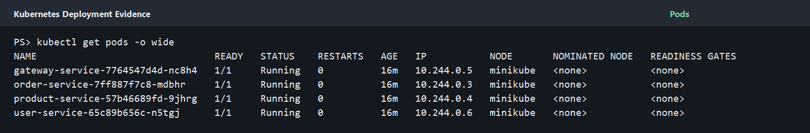
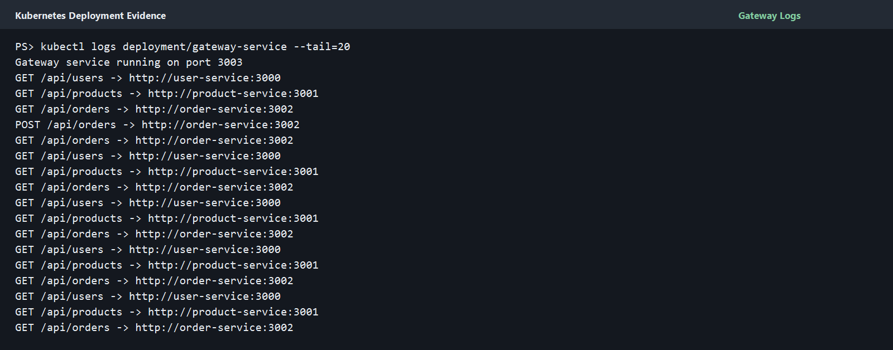
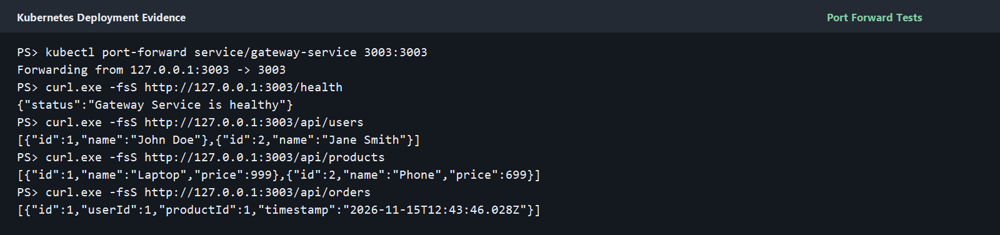
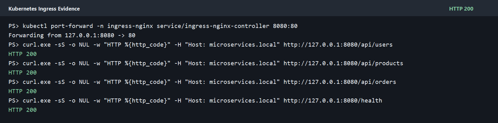

# Microservices on Kubernetes

This repository contains the User, Product, Order, and Gateway Node.js services, Dockerfiles for building their local images, and Kubernetes deployment artifacts.

The [step-by-step Minikube deployment guide](submission/README.md) includes setup, image builds, `kubectl apply`, service and gateway tests, troubleshooting, and the captured evidence screenshots in `submission/screenshots/`.

## Deployment Evidence

**Running Pods**

**Service Communication Logs**

**Port-Forwarded Tests**

**Ingress Routing**

