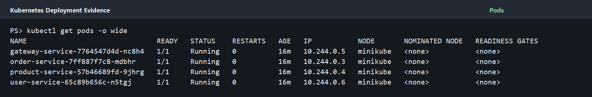
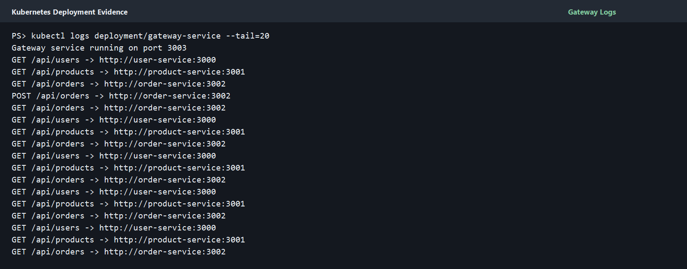
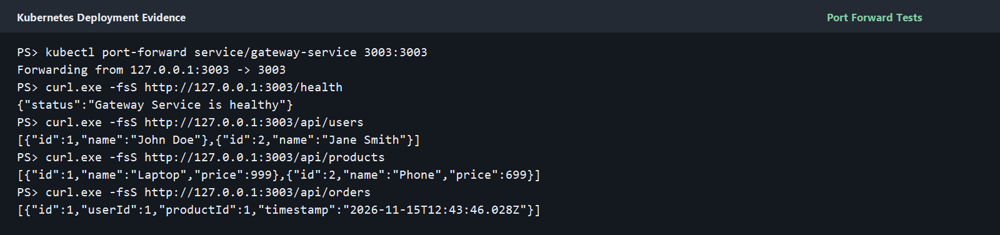
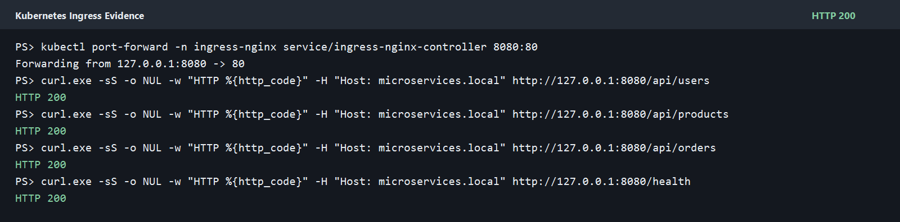

# Microservices Deployment on Minikube

This guide covers building and deploying the User, Product, Order, and Gateway Node.js services on Kubernetes with Minikube. The four application Services are `ClusterIP`; the gateway discovers its backends through Kubernetes DNS. Each Deployment has resource requests and limits and liveness/readiness probes at `/health`.

## Prerequisites

- Windows 10/11 with Docker Desktop installed and using the Linux container engine.
- PowerShell, `kubectl`, and Minikube.
- Run commands from the repository root, containing both `Microservices` and `submission`.

Check installed tools and the Docker daemon:

```powershell
minikube version
kubectl version --client
docker info
```

If Minikube is not installed, install it with Winget from a PowerShell terminal:

```powershell
winget install --id Kubernetes.minikube --exact --accept-package-agreements --accept-source-agreements
```

Open a new terminal after installation so PATH is refreshed. Start Docker Desktop if needed:

```powershell
docker desktop start
```

## Start the Cluster

Use Docker Desktop as the Minikube driver, then confirm the node is Ready:

```powershell
minikube start --driver=docker
kubectl get nodes
kubectl config current-context
```

The current context should be `minikube`. On the authoring machine the Winget install did not refresh the existing Bash session's PATH; the installed executable was at `C:\Program Files\Kubernetes\Minikube\minikube.exe`. A new PowerShell window normally resolves `minikube` without needing the full path.

## Build the Service Images

Build each Dockerfile into Minikube's image store. Image tags match the Deployments, which use `imagePullPolicy: Never`:

```powershell
minikube image build -t user-service:1.0.0 .\Microservices\user-service
minikube image build -t product-service:1.0.0 .\Microservices\product-service
minikube image build -t order-service:1.0.0 .\Microservices\order-service
minikube image build -t gateway-service:1.0.0 .\Microservices\gateway-service
minikube image ls
```


The Dockerfiles use Node.js 20 Alpine, install production dependencies, and run as the unprivileged `node` user.

## Deploy with kubectl

Apply the ClusterIP Services first, followed by the Deployments:

```powershell
kubectl apply -f .\submission\services\
kubectl apply -f .\submission\deployments\
```

Wait for each rollout and inspect the pods and service endpoints:

```powershell
kubectl rollout status deployment/user-service
kubectl rollout status deployment/product-service
kubectl rollout status deployment/order-service
kubectl rollout status deployment/gateway-service
kubectl get pods -o wide
kubectl get services
kubectl get endpoints
```

All four pods should be `1/1 Running`; each service should have a pod endpoint on its configured port. Kubernetes DNS names are `user-service:3000`, `product-service:3001`, `order-service:3002`, and `gateway-service:3003`.

## Test Through Port-Forwarding

Start a port-forward in one PowerShell window and leave it running:

```powershell
kubectl port-forward service/gateway-service 3003:3003
```

In a second window, request the gateway health endpoint and each proxied route:

```powershell
curl.exe -fsS http://127.0.0.1:3003/health
curl.exe -fsS http://127.0.0.1:3003/api/users
curl.exe -fsS http://127.0.0.1:3003/api/products
curl.exe -fsS http://127.0.0.1:3003/api/orders
```

Expected responses include healthy status JSON, two users, two products, and the in-memory orders list. To create an order through the gateway:

```powershell
curl.exe -fsS -X POST http://127.0.0.1:3003/api/orders -H "Content-Type: application/json" -d '{"userId":1,"productId":1}'
curl.exe -fsS http://127.0.0.1:3003/api/orders
```

The order service stores orders in memory, so created orders are lost if its pod restarts.

## Test Service DNS Directly

From a temporary pod inside the cluster, call services by their Kubernetes DNS names:

```powershell
kubectl run curl-test --rm -i --restart=Never --image=curlimages/curl:8.10.1 --command -- curl -fsS http://user-service:3000/users
kubectl run curl-test --rm -i --restart=Never --image=curlimages/curl:8.10.1 --command -- curl -fsS http://product-service:3001/products
kubectl run curl-test --rm -i --restart=Never --image=curlimages/curl:8.10.1 --command -- curl -fsS http://order-service:3002/orders
```

The first use may pull the curl image and therefore requires registry access. The gateway route tests also validate its DNS-based communication with the three backend services.

## Logs and Evidence

After making gateway requests, inspect the proxy log entries:

```powershell
kubectl logs deployment/gateway-service --tail=20
```

Recreate the evidence PNGs from current command output while the port-forward is active:

```powershell
powershell.exe -NoProfile -ExecutionPolicy Bypass -File .\submission\capture-evidence.ps1
```

The script runs `kubectl get pods -o wide`, makes live curl requests through `127.0.0.1:3003`, reads gateway logs, and writes the resulting evidence images into `submission/screenshots/`.

**Running Pods**



**Gateway Communication Logs**



**Port-Forwarded Tests**



## Optional Ingress

The NGINX Ingress addon and `microservices-ingress` resource are enabled in the current Minikube cluster. The rule sends `/api` and `/health` for host `microservices.local` to `gateway-service:3003`.

To enable the addon on a fresh cluster and apply the optional manifest:

```powershell
minikube addons enable ingress
kubectl apply -f .\submission\ingress\ingress.yaml
kubectl get ingress
```

Wait for the controller to be Ready:

```powershell
kubectl get pods -n ingress-nginx
kubectl get ingress microservices-ingress -o wide
```

On Docker Desktop for Windows, test host-based routing without editing the hosts file by forwarding a local port to the controller. Leave this command running in a terminal:

```powershell
kubectl port-forward -n ingress-nginx service/ingress-nginx-controller 8080:80
```

From a second terminal, set the Ingress host header on each request:

```powershell
curl.exe -i -H "Host: microservices.local" http://127.0.0.1:8080/api/users
curl.exe -i -H "Host: microservices.local" http://127.0.0.1:8080/api/products
curl.exe -i -H "Host: microservices.local" http://127.0.0.1:8080/api/orders
curl.exe -i -H "Host: microservices.local" http://127.0.0.1:8080/health
```

Each request should return HTTP 200. Alternatively, use `minikube tunnel` or the Minikube IP and add `microservices.local` to `%SystemRoot%\System32\drivers\etc\hosts` (editing the hosts file may require Administrator permissions).

An Ingress-specific capture is also available when port 8080 is forwarded:

```powershell
powershell.exe -NoProfile -ExecutionPolicy Bypass -File .\submission\capture-ingress-evidence.ps1
```

**Ingress Route Test**



Ingress is optional; the ClusterIP services and port-forward tests work without it.

## Troubleshooting

- `minikube` is not recognized: open a new PowerShell after Winget installation. If needed, invoke `C:\Program Files\Kubernetes\Minikube\minikube.exe` directly.
- Minikube cannot connect to Docker: start Docker Desktop and verify `docker info` shows a Server section before running `minikube start --driver=docker`.
- `ErrImageNeverPull` or `ImagePullBackOff`: rebuild the image with the exact tag in the Deployment and confirm it appears in `minikube image ls`.
- A pod is Pending or not Ready: inspect `kubectl describe pod <pod-name>` and `kubectl logs deployment/<service-name>`. Confirm its `/health` endpoint and container port.
- Gateway returns HTTP 500: inspect `kubectl get endpoints` and `kubectl logs deployment/gateway-service`; verify backend Services have endpoints and gateway URL environment variables use matching service names and ports.
- Port-forward fails or curl cannot connect: verify the gateway pod is Ready and Service exists, then restart `kubectl port-forward service/gateway-service 3003:3003`. Port 3003 must be free on the local machine.
- Ingress returns 404 or cannot resolve: check the addon, `kubectl get ingress`, the Minikube IP, and the Windows hosts-file entry.

## Cleanup

Remove the optional Ingress if it was installed, then delete Deployments and Services:

```powershell
kubectl delete -f .\submission\ingress\ingress.yaml
kubectl delete -f .\submission\deployments\
kubectl delete -f .\submission\services\
```
